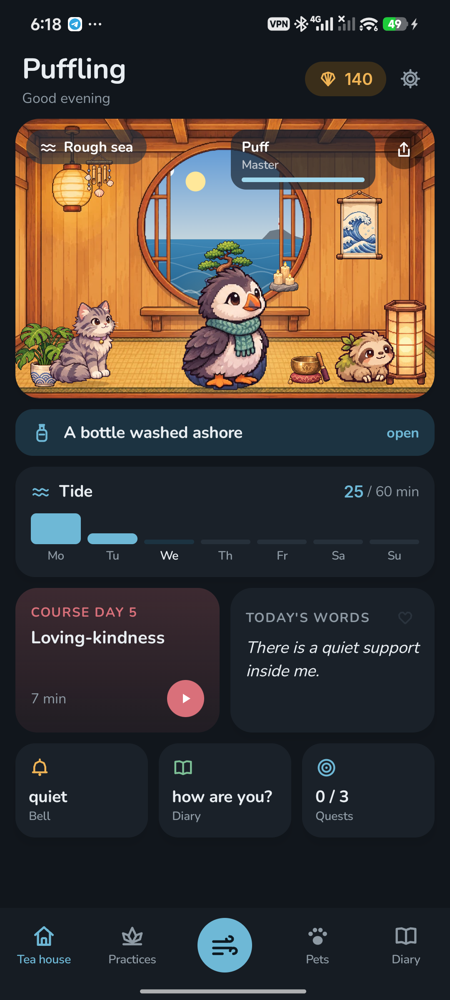
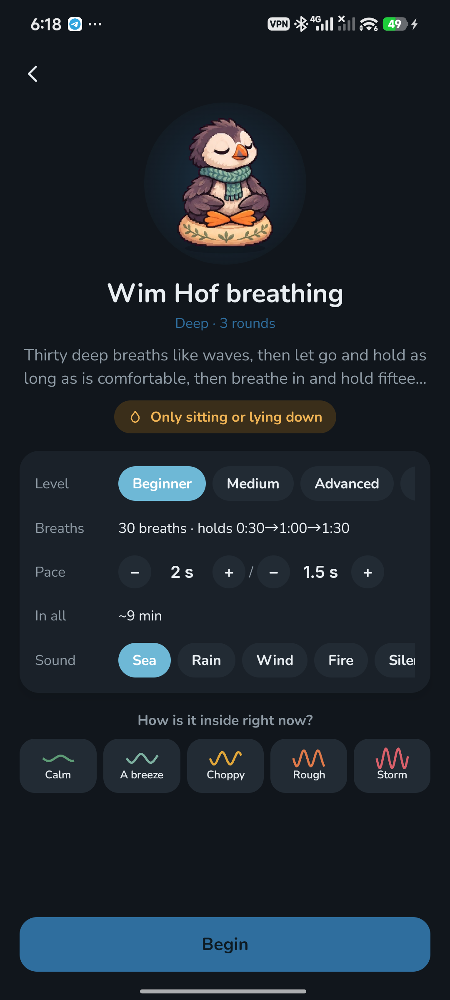
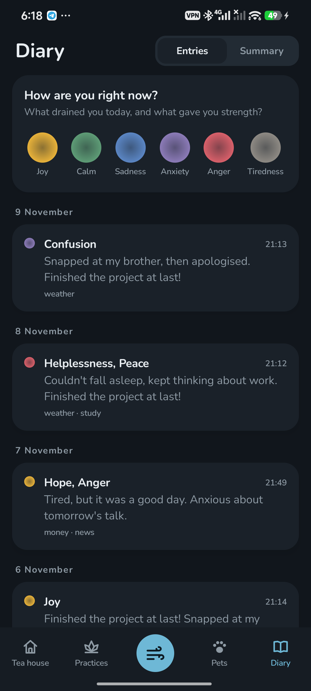

<p align="center"></p>

<h1 align="center">Puffling</h1>

<p align="center">Breathing, quiet, and a puffin chick that breathes with you.<br>
<a href="https://bigdevwhale.github.io/stillcraft/apps/puffling/">Website</a> · <a href="https://github.com/bigdevwhale/puffling/releases/latest/download/Puffling.apk">Download APK</a> · <a href="README.ru.md">Русский</a></p>

A puffin chick lives in a little tea house on a sea cliff. When you breathe, it breathes with you: it puffs up on the in-breath and settles on the out-breath. Breathing practices, Wim Hof, silent sitting, a bell during the day, kind words said aloud and a diary of feelings all feed the pets calm, and they grow at night while they sleep.

<p align="center">



</p>

## What's inside

- **Breathing with a pet.** The pet itself sets the pace, filling out as you breathe in and settling as you breathe out. A soft whoosh of each breath and a light tap at every turn let you breathe with your eyes closed. Eight techniques: box, 4-7-8, coherent, the physiological sigh, the long exhale, alternate nostril and more.
- **Wim Hof.** Four levels with hold targets, and your own pace. While you hold, the pet dives – half a metre a second – and everything it sees down there goes into the aquarium.
- **Stillness, body, attention.** Silent sitting with bells, a body scan, walking meditation, 5-4-3-2-1 grounding, a cup of tea, candle gazing, noting.
- **The bell.** A few times a day, at a random moment, a bell rings softly: stop for three breaths. It stays quiet during calls and in silent mode.
- **Affirmations aloud.** 120 phrases in eight themes, plus your own. The phone listens as you say them, and each one sails off in a bottle and washes back a few weeks later.
- **A diary of feelings.** Six families of feelings with exact words in each, how strong, what it was about, a few lines. The entries add up to a mood map of the week or month.
- **«Rough sea».** One button for a hard moment: three sighs of relief and grounding.
- **Your own practices.** Breathing to your own count, silence with your own bells, steps in your own words, your own affirmation deck, your own Wim Hof rounds.
- **23 pets,** each with an ability: the sloth loves slow breathing, the pufferfish long holds, the owl evening practice, the chameleon the diary. Eggs turn up from the way you practise.
- **Six courses:** A week of breathing, When anxious, A week of sleep, Wim Hof in three weeks, Ten days of silence and A warm week.
- **A summary.** How much you practised and what helps you in particular – from how it felt before and after. Plus holds, the control-pause test, breaths a minute with the phone on your belly, and the time of day.
- **A tea house with a window.** The round window shows the real sky and weather in your town, and the sea rises towards high tide with every minute of practice this week. Shells furnish the room.
- **No punishment.** The week counts, not every day: a missed day is just low tide.

## Install

Download [Puffling.apk](https://github.com/bigdevwhale/puffling/releases/latest/download/Puffling.apk) on a phone with Android 9 or later, open it and allow installs from that source when Android asks.

## Privacy

No ads, no account, no analytics. Practices, the diary and pets stay on your phone; only your town's coordinates go out, for the weather in the window. Every sound is made inside the app. See [PRIVACY.md](PRIVACY.md).

## Build

JDK 17+ (Android Studio's JBR works) and the Android SDK.

```
git clone https://github.com/bigdevwhale/puffling.git
cd puffling
./gradlew assembleDebug
./gradlew assembleDebug -Pdemo        # app.puffling.demo: four months of practice
```

Kotlin, Jetpack Compose, Room, DataStore. Practices are in `Practices.kt`, affirmations in `Affirmations.kt`, the diary's feelings in `Diary.kt`. The Wim Hof engine and the breath sound come from [SwissZen](https://github.com/bigdevwhale/SwissZen). The pets, the tea house and the sea finds were made with AI image generation (`tools/gen_art.py`, `tools/cut.py`).

## License

MIT. Fonts Nunito, Inter and Press Start 2P (SIL OFL). Weather by [Open-Meteo](https://open-meteo.com) and [MET Norway](https://api.met.no).

Puffling is one of the [StillCraft](https://bigdevwhale.github.io/stillcraft/) apps.
