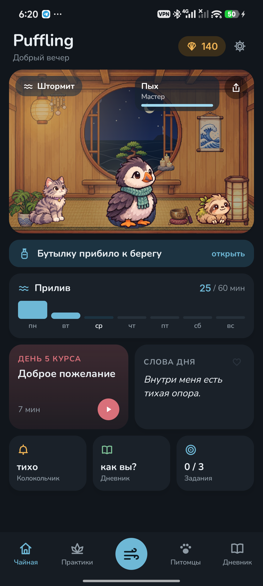
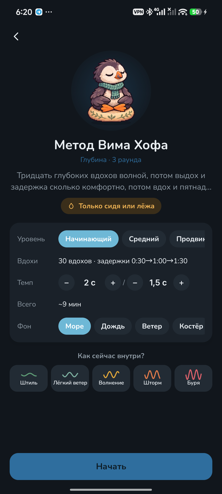
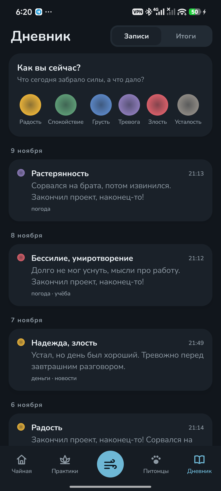

<p align="center"></p>

<h1 align="center">Puffling</h1>

<p align="center">Дыхание, тишина и птенец тупика, который дышит вместе с вами.<br>
<a href="https://bigdevwhale.github.io/stillcraft/apps/puffling/">Сайт</a> · <a href="https://github.com/bigdevwhale/puffling/releases/latest/download/Puffling.apk">Скачать APK</a> · <a href="README.md">English</a></p>

В маленькой чайной на морской скале живёт птенец тупика. Вы дышите – и он дышит с вами: на вдохе надувается, на выдохе сдувается. Дыхательные практики, метод Вима Хофа, тихое сидение, колокольчик среди дня, добрые слова вслух и дневник чувств кормят питомцев спокойствием, а растут они ночью, пока спят.

<p align="center">



</p>

## Что внутри

- **Дыхание с питомцем.** Ритм задаёт сам питомец: раздувается на вдохе и сдувается на выдохе. Тихий шорох вдоха и выдоха и лёгкая вибрация на каждой смене помогают дышать с закрытыми глазами. Восемь техник: квадрат, 4-7-8, ровное дыхание, вздох облегчения, длинный выдох, попеременное и другие.
- **Вим Хоф.** Четыре уровня с целями задержки и свой темп. Пока вы не дышите, питомец ныряет – полметра за секунду, а всё, что он увидел на глубине, попадает в аквариум.
- **Тишина, тело и внимание.** Тихое сидение с колокольчиками, сканирование тела, медленная ходьба, заземление 5-4-3-2-1, чашка чая, пламя свечи, отмечание мыслей.
- **Колокольчик.** Несколько раз в день, в случайный момент, тихо звенит колокольчик: остановитесь на три вдоха. Во время звонка и в беззвучном режиме он молчит.
- **Аффирмации вслух.** 120 фраз на восемь тем и свои. Телефон слушает, как вы их произносите, а каждая сказанная фраза уплывает в бутылке и через несколько недель возвращается к вам.
- **Дневник чувств.** Шесть семей чувств и точные слова в каждой, сила, причины и несколько строк. По записям складывается карта настроения за неделю или месяц.
- **«Штормит».** Кнопка для трудной минуты: три вздоха облегчения и заземление.
- **Свои практики.** Дыхание по своему счёту, тишина со своими колокольчиками, шаги своими словами, своя колода аффирмаций, свои раунды Вима Хофа.
- **23 питомца.** У каждого своя способность: ленивец любит медленное дыхание, рыба-ёж – долгие задержки, сова – вечерние практики, хамелеон – дневник. Яйца находятся по тому, как вы практикуете.
- **Шесть курсов:** «Неделя дыхания», «Когда тревожно», «Неделя сна», «Вим Хоф, три недели», «Десять дней тишины» и «Тёплая неделя».
- **Итоги.** Сколько вы практиковали и что помогает именно вам – по тому, как было до практики и после. А ещё задержки, тест контрольной паузы, число вдохов в минуту с телефоном на животе и время суток.
- **Чайная с окном.** За круглым окном настоящее небо и погода вашего города, а море поднимается к приливу с каждой минутой практики за неделю. За ракушки чайную можно обставить.
- **Без наказаний.** Важна неделя, а не каждый день: пропущенный день – просто отлив.

## Установка

Скачайте [Puffling.apk](https://github.com/bigdevwhale/puffling/releases/latest/download/Puffling.apk) на телефон с Android 9 или новее, откройте файл и разрешите установку из этого источника, когда Android спросит.

## Приватность

Без рекламы, аккаунта и аналитики. Практики, дневник и питомцы хранятся только на телефоне. В сеть уходят лишь координаты города, чтобы показать погоду за окном. Все звуки создаются прямо в приложении. Подробнее – в [PRIVACY.md](PRIVACY.md).

## Сборка

JDK 17+ (подойдёт JBR из Android Studio) и Android SDK.

```
git clone https://github.com/bigdevwhale/puffling.git
cd puffling
./gradlew assembleDebug
./gradlew assembleDebug -Pdemo        # app.puffling.demo: четыре месяца практик
```

Kotlin, Jetpack Compose, Room, DataStore. Практики описаны в `Practices.kt`, аффирмации – в `Affirmations.kt`, чувства дневника – в `Diary.kt`. Движок метода Вима Хофа и звук дыхания взяты из [SwissZen](https://github.com/bigdevwhale/SwissZen). Питомцы, чайная и находки нарисованы нейросетью (`tools/gen_art.py`, `tools/cut.py`).

## Лицензия

MIT. Шрифты Nunito, Inter и Press Start 2P (SIL OFL). Погода – [Open-Meteo](https://open-meteo.com) и [MET Norway](https://api.met.no).

Puffling – одно из приложений [StillCraft](https://bigdevwhale.github.io/stillcraft/).
